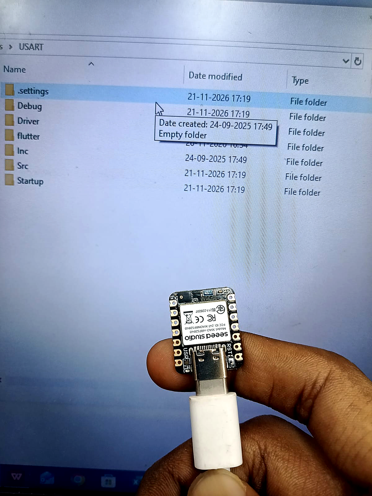

# OBZEN-AirMouse

Wireless Bluetooth Low Energy (BLE) HID air mouse firmware for the **Seeed XIAO nRF52840 Sense** (`XIAO-nRF52840-AirMouse`), powered by its onboard **LSM6DS3** 6-axis IMU (`0x6A`) and **Adafruit Bluefruit nRF52** (`BLEHidAdafruit`).

<a href="nrf52840.png"></a>

## Overview

OBZEN-AirMouse turns a Seeed XIAO nRF52840 Sense into a motion-controlled wireless mouse over Bluetooth Low Energy. Gyroscope and accelerometer readings from the onboard LSM6DS3 are filtered, mapped through a deadzone and sensitivity/acceleration curve with sub-pixel precision, and sent as standard BLE HID mouse reports (`dx`, `dy`)—requiring no USB dongle, companion receiver, or Python script on the host computer.

## Features

- **Direct BLE HID Mouse:** Advertises as `OBZEN-AirMouse` (`BLE_APPEARANCE_HID_MOUSE`) with a fast 7.5–15 ms connection interval and pairs directly with your laptop's built-in Bluetooth stack.
- **Grip & Orientation Detection:** Automatically switches between horizontal (`HORIZ`) and upright (`UPRIGHT`) grips (`AUTO_ORIENTATION`) with debounce (`ORIENT_HOLD_MS`) or locks to a chosen grip (`MANUAL_HOLD_MODE`).
- **Smooth Pointer & Drift Control:** Runs a 125 Hz (`8 ms`) loop with gyroscope bias calibration (`calibrateGyro()`), axis-specific deadzones (`DEADZONE_X`, `DEADZONE_Y`), low-pass smoothing (`SMOOTHING`), base sensitivity (`BASE_SENSITIVITY`), acceleration gain (`ACCEL_GAIN`), balanced vertical scaling (`PITCH_SCALE`), and sub-pixel remainder accumulation.
- **Soft Tap & Double-Tap Clicks:** Detects gentle tap impulses (`SOFT_TAP_DELTA_G`, `SOFT_TAP_IMPULSE_G`) with brief cursor stabilization so single taps click and soft double-taps open files/folders reliably.
- **Auto-Sleep & Wake-on-Motion:** Enters low-power sleep (`sd_power_system_off()`) after 30 seconds of stillness (`IDLE_SLEEP_MS`) and configures the IMU wake-up interrupt (`WAKE_PIN`) to wake immediately when picked up.
- **Optional Serial Telemetry:** Can print periodic status lines (`grip:`, `maxDeltaG:`, `maxGyro:`, `clicks:`, `idleSec:`) at 115200 baud when `ENABLE_SERIAL_LOG` is enabled.

## How It Works

1. **Startup Calibration (~1.5 s):** When powered on, `calibrateGyro()` samples the stationary LSM6DS3 gyroscope (`300` samples) to compute and subtract resting drift biases (`biasX`, `biasY`, `biasZ`).
2. **125 Hz Motion Pipeline:** Every `8 ms` (`LOOP_INTERVAL_MS`), the firmware reads 6-axis IMU data over 400 kHz I2C, determines grip orientation (`HORIZ` vs. `UPRIGHT`), applies low-pass filtering and a non-linear speed curve (`applyCurve()`), and accumulates fractional sub-pixel movement (`remX`, `remY`) before transmitting integer `(dx, dy)` steps via `blehid.mouseMove()`.
3. **Impulse Tap Detection:** The accelerometer watches for sharp, light tap impulses (`deltaG` + `tapImpulse`) while ignoring normal smooth wrist sweeps. A single tap sends a left-click; two soft taps within `420 ms` send a crisp double-click while briefly freezing pointer jitter so both clicks hit the exact target icon.
4. **Power Management:** If movement stays below `STILL_DELTA_G` and `STILL_GYRO_DPS` for `30 s`, the nRF52840 enters deep sleep and wakes automatically via the LSM6DS3 hardware motion interrupt.

## Laptop Bluetooth Connection

No drivers or third-party software are needed—Windows, macOS, and Linux recognize `OBZEN-AirMouse` natively as a standard Bluetooth mouse:

1. **Power the Board:** Flash `AirMouse.ino` to your Seeed XIAO nRF52840 Sense and keep the board resting still for ~2 seconds after power-up while gyro calibration completes.
2. **Open Laptop Bluetooth Settings:**
   - **Windows:** Go to **Settings → Bluetooth & devices → Add device → Bluetooth**.
   - **macOS:** Go to **System Settings → Bluetooth**.
   - **Linux:** Open your system Bluetooth manager (or `bluetoothctl`).
3. **Pair `OBZEN-AirMouse`:** Select **`OBZEN-AirMouse`** from the discovered devices list and click **Connect / Pair**. Once connected, moving the board immediately moves your laptop's cursor.
4. **Auto-Reconnect & Wake:** After initial pairing, the board automatically re-advertises on disconnect and reconnects when woken from sleep by moving or picking it up.

## How to Use


- **Move Cursor:** Hold the board comfortably (flat like a TV remote or upright like a wand) and tilt/turn your wrist smoothly to guide the arrow across the screen.
- **Single Click (Select):** Point at an item and give the board a gentle tap with your finger.
- **Double-Click (Open File / Folder):** Point at a file or folder icon, hold steady, and tap twice softly within `420 ms`.
- **Sleep & Wake:** Set the board down on a desk—after 30 seconds of stillness it enters low-power sleep; pick it up or nudge it to wake and resume control.

## Hardware & Libraries

- **Board:** Seeed XIAO nRF52840 Sense (with onboard LSM6DS3 IMU at I2C address `0x6A`)
- **Headers / Libraries Used in `AirMouse.ino`:**
  - `bluefruit.h` (`BLEHidAdafruit`, `BLEDis`) — nRF52 BLE stack and HID mouse profile
  - `LSM6DS3.h` — onboard 6-axis IMU driver
  - `Wire.h` — I2C communication
  - `math.h` — standard math functions (`atan2`, `cos`, `sin`, `fabs`, `trunc`)
  - `nrf_gpio.h` — nRF52 GPIO / wake-up pin hardware support

> **Note:** These headers come from your Seeed nRF52 Arduino board package and installed libraries—they do not need to be copied into this repository.

## Folder Structure

```text
OBZEN-AirMouse/
├── AirMouse.ino
├── README.md
└── docs/
    ├── air-mouse-demo.png
    └── tap-to-open-demo.gif
