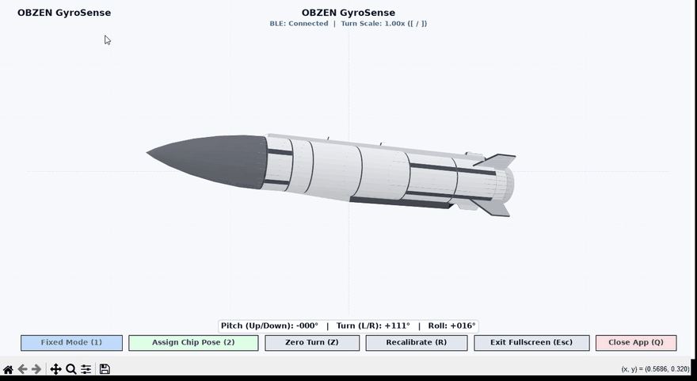
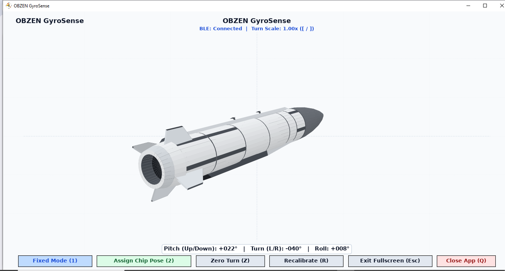
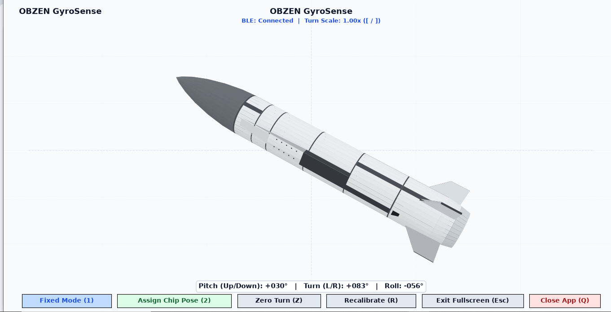

# OBZEN GyroSense

**OBZEN GyroSense** is a real-time 3D airframe attitude telemetry visualizer built in Python for the **Seeed Studio XIAO nRF52840 Sense**. It connects over **Bluetooth Low Energy (BLE)** to stream 6-axis IMU data (accelerometer and gyroscope) and renders a 3D Grom-E1 airframe with smooth orientation tracking.

---

## Features

* **BLE Telemetry Streaming:** Automatically scans for and connects to `XIAO-IMU` over characteristic `19B10001-E8F2-537E-4F6C-D104768A1214`, with automatic reconnection if the BLE link drops.
* **Dual Orientation Tracking Modes**
  * **Fixed Mode (`1`):** Uses fixed physical chip-to-airframe axis mapping (`USB port = Tail / Nozzle`, `Opposite USB = Head / Nose Cone`).
  * **Assign Chip Pose (`2`):** Keeps the rocket in its current on-screen orientation without jumping and dynamically assigns whichever physical side of the chip is currently pointing upward as the rocket's head/top reference.
* **Safe Calibration Hold:** Calibrates gyroscope bias and gravity alignment for **2 seconds** on startup or recalibration while holding the airframe upright until you choose a mode.
* **Smooth 3D Rendering:** Renders a 3D mesh in `matplotlib` using orthonormal rotation matrices, complementary filtering, continuous `[-180°, 180°)` angle wrapping, and directional shading.

---

## BLE & Hardware Details

* **Board:** Seeed Studio XIAO nRF52840 Sense (onboard LSM6DS3 6-axis IMU)
* **BLE Device Name:** `XIAO-IMU`
* **BLE Characteristic UUID:** `19B10001-E8F2-537E-4F6C-D104768A1214`
* **Binary BLE Notification Payload (`16 bytes`, Little-Endian `<Ihhhhhh`):**

| Offset | Type | Field | Scaling / Units |
| :--- | :--- | :--- | :--- |
| `0..3` | `uint32` | `t_ms` | Timestamp in milliseconds (`ms`) |
| `4..5` | `int16` | `ax` | X-axis acceleration (`raw / 1000.0` in $g$) |
| `6..7` | `int16` | `ay` | Y-axis acceleration (`raw / 1000.0` in $g$) |
| `8..9` | `int16` | `az` | Z-axis acceleration (`raw / 1000.0` in $g$) |
| `10..11` | `int16` | `gx` | X-axis angular rate (`raw / 10.0` in $^\circ/\text{s}$) |
| `12..13` | `int16` | `gy` | Y-axis angular rate (`raw / 10.0` in $^\circ/\text{s}$) |
| `14..15` | `int16` | `gz` | Z-axis angular rate (`raw / 10.0` in $^\circ/\text{s}$) |

---

## Installation

1. Ensure **Python 3.8+** is installed along with Bluetooth enabled on your computer.
2. Install the required packages:

```bash
pip install matplotlib bleak
```

---

## Running Over Bluetooth (BLE)

Power on your XIAO nRF52840 Sense advertising as `XIAO-IMU` and run:

```bash
python obzen_gyrosense.py
```

If your sensor mounting orientation needs inverted axes at startup, pass any of these flags:

```bash
python obzen_gyrosense.py --flip --flippitch --fliproll
```

---

## Controls & Shortcuts

| Key / Button | Action |
| :--- | :--- |
| **`1`** / **Fixed Mode (1)** | Start fixed-axis tracking (`USB = Tail`, `Opposite USB = Nose`) |
| **`2`** / **Assign Chip Pose (2)** | Bind the chip's current upward-pointing side as the rocket's head |
| **`Z`** / **Zero Turn (Z)** | Reset horizontal turn (yaw) heading straight ahead |
| **`R`** / **Recalibrate (R)** | Return rocket upright, recalibrate for 2 seconds, and wait for mode choice |
| **`F`** | Flip turn (yaw) direction Left/Right |
| **`P`** | Flip pitch direction Up/Down |
| **`B`** | Flip roll direction Left/Right |
| **`[` / `]`** | Decrease / Increase turn sensitivity (`0.05x` to `1.50x`) |
| **`Esc` / `F11`** | Exit / Toggle fullscreen |
| **`Q`** / **Close App (Q)** | Quit the application |

---
## UI & Live Demo








## How to Use

1. Launch `obzen_gyrosense.py` and wait for it to scan and connect to **`XIAO-IMU`**.
2. Keep the board still for **2 seconds** while the rocket holds upright (`Pitch: +90°`) during calibration.
3. Choose your tracking mode:
   * Press **`1`** for standard fixed-axis mapping (`USB port` at the tail, opposite end at the nose).
   * Hold any desired side/edge of the board pointing upward and press **`2`** to assign that orientation as the rocket's head without jumping the on-screen pose.
4. Use **`Z`** to zero turn heading or **`R`** to recalibrate at any time.
